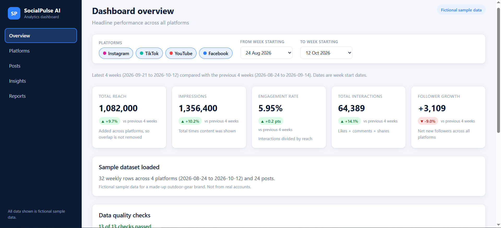
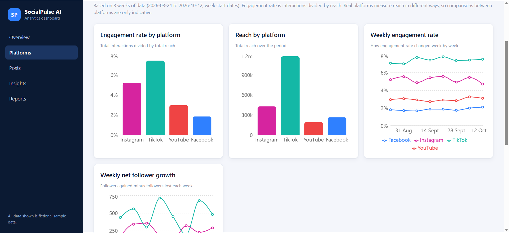
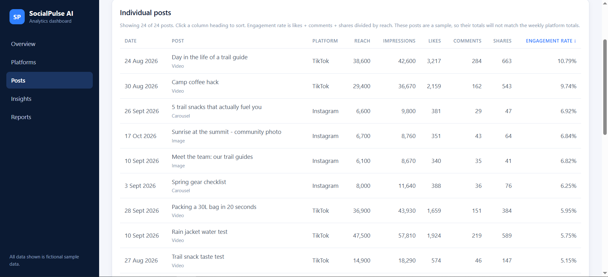
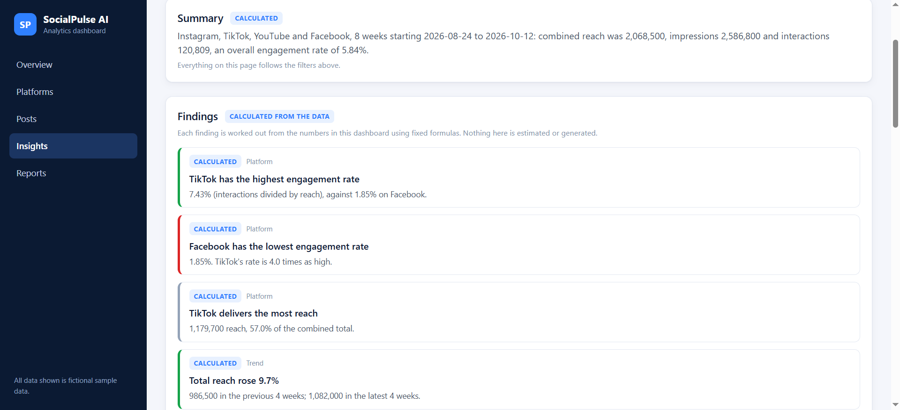
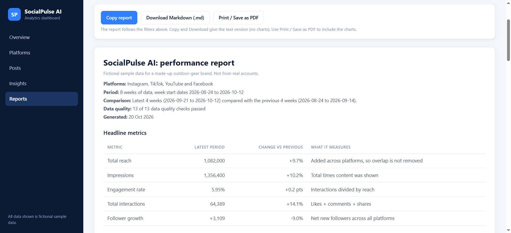

# SocialPulse AI

**A responsive social media analytics dashboard built with React, TypeScript, and Vite.**

Explore performance metrics, compare social platforms, review calculated insights, filter sample data, and generate shareable reports.

🚀 **Live Demo:** [Open SocialPulse AI](https://socialpulse-ai-khaki.vercel.app/)

💻 **Source Code:** [View on GitHub](https://github.com/FKakora/SocialPulseAI)

> **Data disclaimer:** All data is fictional and represents a made-up outdoor-gear brand. No real social media accounts are connected. Insights and suggestions are generated using fixed, rule-based code; no AI model is integrated into the application itself.

## Features

- **Overview Dashboard:** View key performance indicators and overall social media performance.
- **Platform Comparisons:** Compare Instagram, TikTok, YouTube, and Facebook performance and trends.
- **Posts Table:** Review and sort sample social media posts.
- **Insights:** Explore calculated findings and rule-based suggestions.
- **Reports:** Copy, download, or print reports, including saving them as PDFs through the browser.
- **Filtering:** Filter sample data to explore different views.
- **Data Validation:** Run 13 automated data-quality checks to identify potential data issues.

## Tech Stack

- React 19
- TypeScript 6
- Vite 8
- Recharts 3
- Git and GitHub
- Vercel for deployment

## Screenshots

### Overview Dashboard



### Platform Comparisons



### Posts



### Insights



### Reports



## Getting Started

### Prerequisites

- Node.js and npm installed.

### Installation

Clone the repository:

```bash
git clone https://github.com/FKakora/SocialPulseAI.git
```

Open the project folder:

```bash
cd SocialPulseAI
```

Install dependencies:

```bash
npm install
```

Start the development server:

```bash
npm run dev
```

Open the local URL displayed in your terminal.

## Available Scripts

| Command | Description |
|---|---|
| `npm run dev` | Start the development server |
| `npm run build` | Build the application for production |
| `npm run preview` | Preview the production build |
| `npm run lint` | Run the configured lint checks |

## Project Structure

```text
src/
├── data/
│   └── sampleData.ts
├── lib/
│   ├── validation
│   ├── metrics
│   ├── chartData
│   ├── filters
│   ├── kpis
│   ├── insights
│   ├── report
│   ├── format
│   └── download
└── components/
```

The project separates sample data, calculations, validation, report generation, formatting, and reusable UI components.

*Note: The structure above highlights key areas; individual filenames and folders may vary slightly.*

## Dataset and Metric Definitions

The dashboard uses fictional sample data covering eight weeks, four social media platforms, and 24 posts for a made-up outdoor-gear brand.

Metrics and visualisations are calculated from this sample dataset. Results should be interpreted as demonstration data, not real business performance.

## Data Quality

The application includes 13 automated data-quality checks designed to help identify potential problems in the sample data.

These checks demonstrate validation and data-reliability practices that are important when building analytics dashboards.

## Limitations

- The application uses fictional sample data.
- It does not connect to real social media accounts or platform APIs.
- Insights and suggestions are produced by fixed, rule-based logic.
- No AI model or AI API is integrated into the application itself.
- Data is not persisted through a backend database.

## Possible Next Steps

- Add automated tests for calculation and data-validation logic.
- Support CSV imports with schema validation and data-quality checks.
- Introduce daily data for more flexible date filtering and monthly reporting.
- Explore AI-generated suggestions through a secure backend, keeping calculated findings separate from AI-generated content.
- Consider persistent storage and supported social media API integrations.

## What I Learned

This project demonstrates practical experience with React, TypeScript, data visualisation, reusable components, data validation, filtering, report generation, Git-based version control, and deployment using Vercel.

It also demonstrates the use of AI-assisted development as a support tool while building and troubleshooting a software project.

## Author

**Ferlando Kakora**

- **Live Demo:** https://socialpulse-ai-khaki.vercel.app/
- **GitHub Repository:** https://github.com/FKakora/SocialPulseAI
